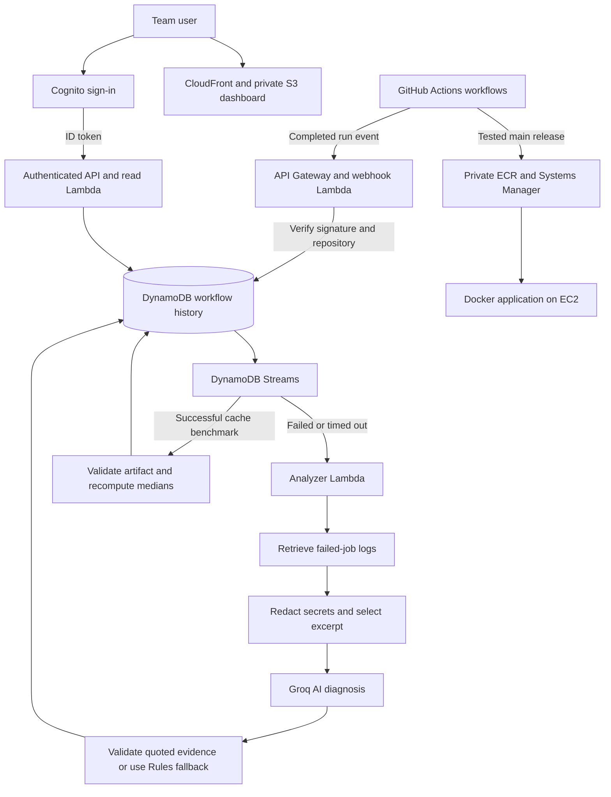

# DeployIQ — Faculty Presentation Guide

**Project title:** DeployIQ: AI-Assisted CI/CD Monitoring and Failure Diagnosis with Measured Cache Optimization  
**Project type:** Team-built DevOps and cloud computing prototype  
**Platform:** AWS infrastructure, GitHub Actions automation, and Groq AI inference  
**Audience:** Faculty review, project demonstration, and technical discussion

[Dashboard](https://d27iom2n4u9pw.cloudfront.net/) ·
[Technical README](../README.md) · [Detailed demo script](../docs/DEMO.md) ·
[Experiment methodology](../evaluation/README.md)

## 1. Project overview

DeployIQ helps a development team understand what happened in its software
pipeline, why a workflow may have failed, and what correction should be reviewed.
It combines completed GitHub Actions workflow records, AI-assisted log diagnosis,
and measured dependency-cache experiments in one authenticated dashboard.

A CI/CD pipeline automates activities such as testing, packaging, and deployment.
When one of these activities fails, a developer still needs to inspect the logs,
identify the relevant error, choose a correction, and rerun the workflow.
DeployIQ supports that investigation by presenting a likely cause alongside
exact evidence from the logs and suggested verification steps.

The project also investigates a specific performance question: **does reusing a
pip download cache reduce dependency installation time in our test setup?** It
reports actual baseline, cold-cache, and warm-cache measurements rather than
assuming that caching always improves the entire pipeline.

### Abstract

DeployIQ is a cloud-hosted prototype for monitoring and explaining GitHub Actions
workflow outcomes. A signature-verifying webhook stores completed attempts in
Amazon DynamoDB. DynamoDB Streams triggers asynchronous failure analysis, which
retrieves failed-job logs, redacts common secret patterns, and requests a diagnosis
from Groq. The response is accepted only when its evidence quotes appear in the
supplied log excerpt; otherwise, a clearly labeled Rules fallback is shown.
An authenticated React dashboard displays run history, diagnosis, and validated
cache-benchmark reports. A separate delivery pipeline tests and deploys a Dockerized
FastAPI application to Amazon EC2. The project's contribution is the integration
of evidence validation, explicit diagnosis provenance, human-reviewed correction,
and reproducible installation-time measurements in a working student prototype.

### Thirty-second introduction

> Good morning, ma'am. Our project is DeployIQ, an AI-assisted DevOps monitoring
> system. It collects GitHub Actions workflow results and explains failed runs
> using actual log evidence. Developers can review the suggestion, apply a fix,
> and check a new run. We also measure the effect of dependency caching and show
> both the results and their limitations. Our application and monitoring system
> run on AWS, with Groq providing the AI diagnosis.

## 2. Problem statement and motivation

A failed pipeline presents two different questions: **what failed, and what
should the developer investigate next?** A status badge answers the first only
partially. Raw logs contain more detail, but a developer must locate the relevant
error and interpret it in context.

Performance improvement raises another question: **did an optimization actually
help under the conditions measured?** A configuration change alone cannot answer
that. It needs a repeatable experiment and a clearly defined metric.

DeployIQ addresses these needs through a shared workflow history, an explanation
supported by log quotes, and an explicit comparison of dependency installation
timings. It is intended to assist developer decisions. This project has not yet
measured whether it reduces real developer investigation time.

## 3. Main goal and objectives

**Main goal:** Build a working system that connects CI/CD execution, observable
failure evidence, AI-assisted explanation, and measured optimization results.

| Objective | Implementation | How to demonstrate it |
| --- | --- | --- |
| Automate application delivery | GitHub Actions tests, Docker build and smoke check, private ECR, and SSM deployment to EC2. | Show a successful CI run and describe the release path. |
| Collect trustworthy workflow records | Signed webhook validation, repository identity checks, and duplicate-attempt prevention. | Show completed runs with their run IDs, commits, and outcomes. |
| Help explain failed jobs | Groq diagnosis of a bounded, sanitized log excerpt. | Open an intentionally failed dependency-check run. |
| Make the evidence inspectable | Require returned quotes to occur in the supplied excerpt. | Compare the diagnosis quote with the displayed error. |
| Handle unavailable AI honestly | Explicit Rules fallback, cached results, and a daily AI request cap. | Explain the source label and error behavior; do not induce an outage on stage. |
| Present information to the team | Cognito sign-in and an authenticated read API for the React dashboard. | Sign in and navigate through real run details. |
| Evaluate a concrete optimization | Repeatable pip-cache experiment with pinned dependencies and fresh environments. | Show both recorded experiments and explain the metric. |

The desired benefits are easier investigation and better-informed optimization
choices. Broader diagnostic accuracy, time savings, and production reliability
improvements remain evaluation goals, not established outcomes.

## 4. Presentation agenda

Suggested duration: **10–12 minutes, followed by questions**. Live workflow time
may vary; keep disclosed completed runs ready as backup.

| Order | Topic | Suggested time | Main message |
| --- | --- | --- | --- |
| 1 | Introduction and problem | 1 minute | Pipeline status needs supporting context and evidence. |
| 2 | Goals and current scope | 1 minute | Explain what this prototype implements. |
| 3 | Architecture and technology | 2 minutes | Follow an event from GitHub to the dashboard. |
| 4 | Failure and diagnosis demonstration | 2 minutes | Show the actual error, Groq label, and quoted evidence. |
| 5 | Reviewed fix and passing run | 1 minute | A human applies the correction and checks another run. |
| 6 | Cache experiment and results | 1–2 minutes | Report both experiments and the measurement boundaries. |
| 7 | Novelty, limitations, and future scope | 2 minutes | Explain the engineering contribution without overclaiming. |

## 5. Architecture and working process



The diagram shows logical stages. Diagnosis and benchmark import share the same
analyzer Lambda. The frontend fetches pipeline data through the authenticated API;
it does not connect directly to DynamoDB or receive the Groq API key.

### A. Application delivery

A push starts the CI checks. After the required checks pass on the main branch,
the workflow uploads a tested Docker image to private ECR. Systems Manager runs
the deployment on EC2. A candidate health check runs before replacement, followed
by a check of the replacement service. If replacement fails, the script attempts
to restore the previous container. This approach can have a brief interruption.

### B. Monitoring and diagnosis

1. GitHub sends a completed workflow event to the webhook endpoint.
2. The webhook verifies its HMAC signature and configured repository identity.
3. The completed run attempt is stored once in DynamoDB.
4. A failed or timed-out INSERT triggers the analyzer asynchronously.
5. The analyzer retrieves logs for that exact attempt, redacts common secret
   patterns, and limits the context sent to Groq.
6. Groq suggests a likely cause, evidence, a correction, and verification steps.
7. Local validation checks the response structure and exact evidence quotes.
8. The dashboard displays the saved result with its source: **Groq AI** or **Rules**.

### C. Cache measurement

A dedicated workflow performs dependency installations with and without a reused
local pip cache. It publishes a report artifact. After successful completion,
the importer checks repository, commit, run, and attempt identity, recomputes the
medians, and stores the validated report. Viewing the report does not call AI or
rerun the experiment.

### D. Team access

CloudFront serves the dashboard assets from private S3. Cognito authenticates
invited users, and the read API requires an ID token. The current project has
one shared repository workspace; it does not isolate unrelated customer teams.

## 6. Technology choices

| Technology | Role in DeployIQ |
| --- | --- |
| GitHub Actions | CI execution, intentional diagnosis demo, dashboard publishing, and cache experiment. |
| FastAPI and Docker | Small testable application packaged consistently for deployment. |
| Amazon ECR, EC2, and Systems Manager | Private image storage and remote container deployment. |
| API Gateway and Lambda | Webhook processing, diagnosis, artifact import, and read API. |
| DynamoDB and Streams | Persistent run records and asynchronous event triggers. |
| Groq API | Inference using `openai/gpt-oss-120b` in the deployed configuration. |
| Secrets Manager | Separate private storage for the Groq key and GitHub Actions read token. |
| Cognito | Invited team-user authentication. |
| React, S3, and CloudFront | Dashboard UI and HTTPS static delivery. |
| CloudFormation and GitHub OIDC | Repeatable infrastructure definition and temporary AWS workflow credentials. |

Bedrock inference was originally planned, but the account's model quota access
was unavailable and AWS declined the increase request. The deployed analyzer now
uses Groq while retaining the AWS event-processing architecture. Historical
results retain their original source labels.

## 7. Novelty and project contribution

**Our novelty is the design and integration of this prototype, rather than a new
AI model, a new caching algorithm, or a claim to be the first CI diagnosis tool.**
We use an existing model through an API; we did not train it.

| Contribution | What makes it useful in this project |
| --- | --- |
| Evidence-validated diagnosis | A generated explanation must contain quotes found in the actual supplied log excerpt. This makes the evidence inspectable and rejects invented quotes. |
| Visible diagnosis provenance | Groq AI and Rules are labeled separately, so a deterministic fallback is not presented as an AI response. |
| Reproducible optimization evidence | Fresh environments, pinned dependencies, alternating measurement order, and separate cold/warm samples support a transparent comparison. |
| One interface for runs and measurements | Workflow history, diagnosis, and benchmark details are available in the same authenticated dashboard. |
| Asynchronous processing with bounded AI use | Webhook ingestion stays separate from slower analysis; a daily cap and completed-result caching limit repeated calls. |
| Artifact identity validation | Benchmark data is accepted only for the expected repository, commit, run, and attempt before summary values are recomputed. |

Evidence matching is a validation safeguard, not proof that the model's causal
explanation is correct. The dependency demonstration alone does not establish
accuracy across every class of CI failure. No comparative study against
commercial DevOps tools has been completed.

## 8. Current scope

### Implemented scope

- One GitHub repository and a shared invited team workspace.
- Completed workflow monitoring, including success, failure, and timed-out runs.
- Failed-job log analysis, bounded excerpts, and common-secret redaction.
- AI-assisted suggestions with validated evidence and an explicit Rules fallback.
- Main-branch Docker delivery to an EC2 sample service.
- Authenticated dashboard access and persistent run details.
- A local pip download-cache experiment and validated report display.
- Infrastructure configuration, setup guides, and a repeatable demonstration.

### Outside the current scope

- Autonomous code edits, pull requests, or automatic application of AI fixes.
- Automatic linking of a passing rerun to a previous diagnosis or marking it fixed.
- A guarantee of root-cause correctness or universal secret removal.
- Multi-repository onboarding and isolation between unrelated organizations.
- Continuous application tracing, incident management, or a full observability platform.
- Kubernetes orchestration, highly available deployment, or zero-downtime guarantees.
- Optimization of the entire build/deploy process or a demonstrated cloud-cost saving.
- A custom-trained model or a comprehensive diagnosis-accuracy benchmark.

## 9. Results and how to explain them

### Failure diagnosis

The hosted dashboard showed **Groq AI** for the controlled missing-dependency
failure, with this evidence:

```text
ModuleNotFoundError: No module named 'requests'
```

The suggested correction was to install the required dependency before importing
it. To demonstrate verification, run the same demo with **install_dependency**
enabled and show its actual successful outcome. The system does not update the
original failed record's verification label automatically.

Observed Groq diagnosis:
[GitHub run 39475900064](https://github.com/Bhanuch2006/deployiq/actions/runs/39475900064).
Record the current passing rerun's ID during rehearsal instead of assuming it
from the suggestion.

### Cache experiment

| Experiment | Baseline median | Warm-cache median | Cold-cache fill | Warm installation change |
| --- | --- | --- | --- | --- |
| [38903048448](https://github.com/Bhanuch2006/deployiq/actions/runs/38903048448) | 2.29 seconds | 1.82 seconds | 2.42 seconds | 20.73% faster |
| [38908962867](https://github.com/Bhanuch2006/deployiq/actions/runs/38908962867) | 2.90 seconds | 2.77 seconds | 3.58 seconds | 4.30% faster |

Each experiment uses **four uncached samples, one cold-cache sample, and three
warm-cache samples**, with a new virtual environment for each installation.
The percentages use unrounded measurements; table values are rounded.

```text
Improvement (%) = (baseline median - warm-cache median) / baseline median × 100
```

Suggested explanation:

> Both recorded experiments showed faster warm-cache installation, but the
> amount varied. The cold fill was slower than the baseline median in both
> experiments. We report all these values because cache state and execution
> conditions matter. These results measure pip installation time only.

The experiment excludes remote GitHub cache upload/download overhead, total job
time, and deployment time. Network and shared-runner variation remain. Two runs
and their small sample counts do not prove a general performance guarantee;
further independent trials are needed.

## 10. Live demonstration plan

| Step | Action | What to show ma'am |
| --- | --- | --- |
| 1 | Sign in to the dashboard. | Private team access and real run history. |
| 2 | Run Diagnosis Demo with install_dependency unchecked. | The intentional import failure and its run ID. |
| 3 | Refresh and open that failed run. | Groq AI label, likely cause, exact evidence, and suggested fix. |
| 4 | Run Diagnosis Demo with install_dependency checked. | A human-approved correction and a new passing result. |
| 5 | Open both recorded cache runs. | Baseline, cold fill, warm median, raw samples, and varying gains. |
| 6 | Return to the architecture diagram. | Explain how the components support the observed behavior. |

The diagnosis demo runs separately from the EC2 application and does not break
that service. Keep completed runs and screenshots ready, and identify them as
recorded evidence if used. The [detailed script](../docs/DEMO.md) covers recovery
when a workflow, provider call, or report import is delayed.

## 11. Limitations and future scope

| Current limitation | Future direction | How success could be evaluated |
| --- | --- | --- |
| One shared repository workspace | Controlled multi-repository onboarding and tenant isolation. | Cross-repository authorization and isolation tests. |
| Demonstration covers a narrow failure case | A labeled dataset of dependency, test, permission, and build failures. | Measure diagnosis correctness and unsupported-answer rates against reviewed answers. |
| No automatic failure/fix correlation | Link later passing attempts to an earlier investigation. | Check correct linking across commits, branches, and attempts. |
| Only installation-time caching measured | More independent trials and end-to-end remote-cache experiments. | Include restore/save overhead and report total job time and variability. |
| External inference and quota dependency | Configurable provider selection and clearer retry/recovery controls. | Verify fallback correctness and behavior under provider failures. |
| Best-effort redaction and bounded context | Stronger redaction evaluation and context selection. | Test secret-pattern detection and missed-error cases using synthetic logs. |
| Single-instance container replacement | A more resilient rollout strategy. | Measure availability during rollout and recovery failures. |

These are proposed extensions. They should not be described as implemented
features in the current presentation.

## 12. Suggested four-member presentation split

| Presenter | Responsibility | Evidence to prepare |
| --- | --- | --- |
| Member 1 | Problem, goals, CI/CD, and AWS deployment. | Architecture and successful CI workflow. |
| Member 2 | Log preparation, Groq diagnosis, evidence validation, and novelty. | Failed run with exact quote and source label. |
| Member 3 | Webhook, DynamoDB, API, authentication, and scope. | Event-to-record explanation and access boundaries. |
| Member 4 | Dashboard demo, cache results, limitations, and future work. | Both cache reports and the passing correction run. |

Replace member labels with your team names. Every member should understand the
complete flow and distinguish observed results from intended future benefits.

## 13. Likely faculty questions

**What is the main contribution?**  
A working integration of automated delivery, signed workflow ingestion,
evidence-validated AI assistance, and measured cache reports in an authenticated
team dashboard.

**Why use AI when a missing module is obvious?**  
The missing-module case makes the full flow easy to verify. The intended value is
assisting interpretation of more varied logs, but broader usefulness and accuracy
must be demonstrated with additional failure cases.

**Does the project automatically fix a failure?**  
No. It proposes a correction. A person reviews it, applies it, and checks a new
run. The demo's checkbox enables a predefined dependency-install step.

**What prevents an invented explanation?**  
Response validation rejects evidence quotes absent from the excerpt. This reduces
unsupported evidence, but a model can still misinterpret a real quote. Human
review remains necessary.

**Is the whole system on AWS?**  
AWS hosts the application and monitoring infrastructure. GitHub runs the workflows,
and Groq provides external inference. Sanitized log excerpts leave AWS for that
inference request.

**Did the project improve deployment speed by 20.73%?**  
That percentage applies only to warm pip installation in one recorded experiment.
Another showed 4.30%. Neither establishes an equivalent deployment-time improvement.

**How are credentials handled?**  
GitHub OIDC supplies temporary AWS workflow credentials. The Groq key and GitHub
read token are in Secrets Manager. Browser users sign in through Cognito and
access pipeline data through the authenticated API.

**Is it production-ready?**  
It is a demonstrated student prototype. Production use would require broader
correctness evaluation, stronger isolation, more resilient operations, and
validation of privacy and deployment requirements for the intended environment.

## 14. Closing statement

> DeployIQ demonstrates how workflow events, log evidence, AI assistance, and
> measured optimization can be connected into one practical system. Our current
> prototype explains a controlled failure and presents real cache measurements.
> It keeps human review central and makes its evidence, source labels, and limits
> visible. Our next step is broader evaluation across more failure types and
> execution conditions.

## 15. Final preparation

- Rehearse the full demonstration and record the failed and passing run IDs.
- Save screenshots of Groq diagnosis, the passing correction, and both cache reports.
- Confirm dashboard sign-in, provider access, and token validity before presenting.
- Use the actual recorded numbers and clearly state the measurement boundaries.
- Keep passwords, API keys, and private logs out of projected screens and handouts.
- Use this file as the speaking guide; use the root README for implementation details.
